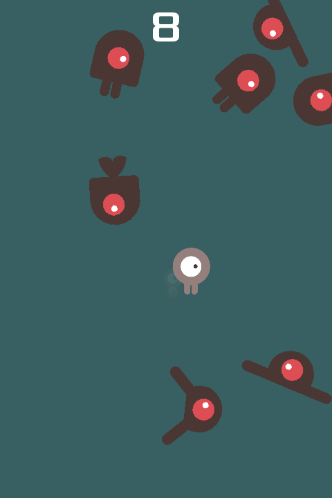

# Game Stats AI Godot example

[Dodge the Creeps](https://github.com/godotengine/godot-demo-projects/tree/master/2d/dodge_the_creeps), the official Godot demo game, with [Game Stats AI](https://gamestats.ai) achievement tracking added. It accompanies the tutorial [How to track achievements in a Godot game](https://gamestats.ai/blog/track-achievements-in-a-godot-game).

The player unlocks an achievement after surviving 10, 30, and 60 seconds. `game_stats.gd` is an autoload that sends each unlock as an [achievement event](https://gamestats.ai/api-docs#tag/achievements/POST/api/v1/accounts/{account_id}/achievement_events) with an `HTTPRequest` node. Unlocks are saved to `user://` before they are sent, so an event that fails while the player is offline is sent again on the next launch.

## Setup

Requires Godot 4.7.

1. Create a **client** token at [gamestats.ai/api_tokens](https://gamestats.ai/api_tokens).
2. Copy the config template and fill in your account id and token:

   ```sh
   cp game_stats.example.cfg game_stats.cfg
   ```

   `game_stats.cfg` is gitignored. Without it, the integration disables itself and the game runs normally.
3. Open the project in Godot and run it.

## Exporting

Godot only exports resource files by default, so `game_stats.cfg` is left out of an exported game unless you add it to the export preset: **Project > Export > Resources > Filters to export non-resource files/folders**, enter `game_stats.cfg`.

---

## Original demo

This is a simple game where your character must move
and avoid the enemies for as long as possible.

This is a finished version of the game featured in the
["Your first 2D game"](https://docs.godotengine.org/en/latest/getting_started/first_2d_game/index.html)
tutorial in the documentation. For more details,
consider following the tutorial in the documentation.

Language: GDScript

Renderer: Compatibility

> [!NOTE]
>
> There is a C# version available [here](https://github.com/godotengine/godot-demo-projects/tree/master/mono/dodge_the_creeps).

Check out this demo on the Asset Store: https://store.godotengine.org/asset/godot-foundation/dodge-the-creeps-demo/

## Screenshots




## License

`art/House In a Forest Loop.ogg` Copyright &copy; 2012 [HorrorPen](https://opengameart.org/users/horrorpen), [CC-BY 3.0: Attribution](https://creativecommons.org/licenses/by/3.0/). Source: https://opengameart.org/content/loop-house-in-a-forest

Images are from "Abstract Platformer". Created in 2016 by kenney.nl, [CC0 1.0 Universal](https://creativecommons.org/publicdomain/zero/1.0/). Source: https://www.kenney.nl/assets/abstract-platformer

Font is "Xolonium". Copyright &copy; 2011-2016 Severin Meyer <sev.ch@web.de>, with Reserved Font Name Xolonium, SIL open font license version 1.1. Details are in `fonts/LICENSE.txt`.
